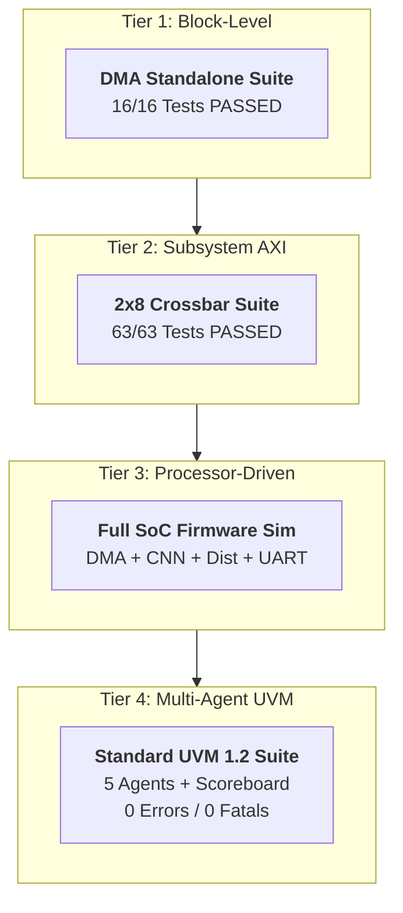

# Verification Test Plan: CNN Anomaly Detection RISC-V SoC

**Project:** CNN Accelerator SoC for Image Anomaly Detection  
**Target Core:** Western Digital VeeR-EL2 RISC-V CPU (RV32IMC)  
**Interconnect:** 32-bit 2x8 AXI4 Crossbar  
**Verification Framework:** Multi-Tier (Direct RTL + Processor-Driven Firmware + IEEE UVM 1.2)  
**Tools:** Synopsys VCS U-2023.03, Synopsys Verdi U-2023.03-SP1, RISC-V GNU GCC 2023.04.29  

---

## 1. Executive Summary & Verification Objectives

The primary objective of this verification plan is to guarantee functional correctness, data integrity, protocol compliance, and mathematical accuracy across all hardware components of the CNN Anomaly Detection SoC.

Verification is executed across **four distinct hierarchical tiers**:
1. **Tier 1 (Block-Level):** Standalone verification of the high-performance DMA controller.
2. **Tier 2 (Subsystem-Level):** Full crossbar interconnect regression verifying CPU and DMA access to all 8 slave peripherals.
3. **Tier 3 (System-Level):** Autonomous processor-driven firmware execution over AXI and UART.
4. **Tier 4 (Standard UVM 1.2):** Standard Multi-Agent UVM environment with 5 dedicated protocol agents and a centralized multi-domain Scoreboard.

---

## 2. System Architecture & Memory Map Under Test

| Slave ID | Peripheral / Memory | Base Address | Size | AXI Protocol | Purpose |
| :---: | :--- | :--- | :---: | :---: | :--- |
| **M00** | Instruction Memory (IMEM) | `0x0000_0000` | 64 KB | AXI4-Lite | Preloaded via `$readmemh`, CPU reset vector |
| **M01** | Data Memory (DMEM) | `0x1000_0000` | 64 KB | AXI4-Lite | Working RAM, Stack, C-to-SV Mailbox (`0x1000_FF00`) |
| **M02** | AXI UART 16550 | `0x2000_0000` | 4 KB | AXI4-Lite | Serial console output (baud divisor 16) |
| **M03** | OpenTitan RISC-V Timer | `0x2000_1000` | 4 KB | AXI4-Lite | 64-bit MTIME / MTIMECMP real-time timer |
| **M04** | PULP Platform GPIO | `0x2000_2000` | 4 KB | AXI4-Lite | 32-bit pin direction, outputs, input sampling |
| **M05** | CNN Accelerator | `0x2000_3000` | 4 KB | AXI4-Lite | 2D Conv + ReLU + MaxPool + FC feature extractor |
| **M06** | Distance / Similarity IP| `0x2000_4000` | 4 KB | AXI4-Lite | Manhattan distance & threshold classification |
| **M07** | AXI DMA Controller (CSR) | `0x2000_5000` | 4 KB | AXI4-Lite | DMA control, source, destination, length |
| **S01** | AXI DMA Master Port | Master on Bus | N/A | AXI4 Burst | Direct Memory Access autonomous transfers |

---

## 3. Verification Hierarchy Breakdown

| Verification Tier | Scope & Testbench | Key Verification Focus | Result |
| :--- | :--- | :--- | :---: |
| **Tier 1: Block-Level** | `tb_dma_axi_wrapper.sv` (`scripts/run_dma_tests.sh`) | DMA single-word, multi-word, 256B bursts, IRQs, W1C status, and fault injections | **16/16 PASSED** |
| **Tier 2: Subsystem AXI** | `tb_cnn_soc_axi_integration.sv` (`scripts/run_soc_regression.sh`) | 2x8 AXI4 crossbar arbitration, routing from CPU (S00) & DMA (S01) to all 8 slaves (M00..M07) | **63/63 PASSED** |
| **Tier 3: Processor-Driven**| `tb_cnn_soc_top.sv` + `main.c` (`scripts/run_cpu_uart_sim.sh`) | Autonomous CPU boot from 0x0000_0000, DMA transfer, CNN inference, distance classification, live UART | **PASSED** |
| **Tier 4: Standard UVM 1.2**| `tb_top_uvm.sv` + `soc_uvm_pkg.sv` (`scripts/run_uvm_anomaly_sim.sh`) | 5 Dedicated Agents (`uart`, `gpio`, `cnn`, `dist`, `dma`) + Central Golden Scoreboard | **0 Errors, 0 Warnings** |

---

## 4. Feature Matrix & Detailed Test Specifications

### Tier 1: Standalone DMA Verification (`scripts/run_dma_tests.sh`)

| Test ID | Test Name | Stimulus / Action | Expected Outcome | Pass Criteria |
| :--- | :--- | :--- | :--- | :---: |
| **DMA-01** | Basic Word Transfer | 4-byte transfer between memory locations | Data written matches source | Word readback verified |
| **DMA-02** | Multi-Word Burst | 64-byte aligned block transfer | Consecutive words written without corruption | Byte-for-byte match |
| **DMA-03** | 256-Byte Image Burst | 256-byte burst to CNN image buffer | Full image transferred | Length == 256, Status DONE=1 |
| **DMA-04** | Interrupt Assertion | Configure `CTRL = 0x05` (START + IRQ_EN) | `dma_irq_o` pulses high upon completion | Pin `dma_irq_o == 1` |
| **DMA-05** | W1C Status Clearing | Write `1` to `STATUS[1]` (DONE) and `STATUS[2]` | Status and IRQ clear to 0 | No driver collision, clears cleanly |
| **DMA-06** | Bad Alignment Fault | Program unaligned source address (e.g. `0x1000_0003`) | Error code raised, transfer blocked | `STATUS.ERROR == 1, ERROR_CODE == 1` |
| **DMA-07** | Zero Length Fault | Program length = 0 | Transfer rejected | `ERROR_CODE == 1` |
| **DMA-08** | Busy Start Fault | Write `START=1` while `BUSY=1` | Second start rejected | `ERROR_CODE == 4` |

---

### Tier 2: SoC AXI Interconnect Multi-IP Regression (`scripts/run_soc_regression.sh`)

| Test ID | Target IP | Base Address | Stimulus / Check | Expected Result |
| :--- | :--- | :--- | :--- | :--- |
| **AXI-01** | UART (M02) | `0x2000_0000` | Program LCR, Divisor Latch, read LSR | `LSR.THRE=1, LSR.TEMT=1`, `resp=OKAY` |
| **AXI-02** | CNN Accel (M05) | `0x2000_3000` | Trigger inference (`CTRL=0x05`), poll DONE | `STATUS.DONE=1`, 16-D embedding readback |
| **AXI-03** | Distance (M06) | `0x2000_4000` | Load matching reference vector, threshold=50 | `MIN_DISTANCE=0`, `RESULT=1 (MATCH)` |
| **AXI-04** | Distance (M06) | `0x2000_4000` | Load divergent reference vector, threshold=50 | `MIN_DISTANCE=800`, `RESULT=0 (ANOMALY)` |
| **AXI-05** | Timer IP (M03) | `0x2000_1000` | Configure MTIME and MTIMECMP, wait match | Timer interrupt asserts on comparator match |
| **AXI-06** | GPIO IP (M04) | `0x2000_2000` | Set output enable, write data patterns | `gpio_o` reflects written patterns |
| **AXI-07** | DMA Controller | `0x2000_5000` | Trigger S01 Master transfer via M07 CSR | Memory block moved autonomously |

---

### Tier 3: Processor-Driven Full Pipeline Verification (`scripts/run_cpu_uart_sim.sh`)

| Phase | Firmware Step | Hardware Actions | Verification Checkpoint |
| :--- | :--- | :--- | :--- |
| **Phase 1** | Boot & Bring-up | CPU executes `crt0.s`, sets stack, configures MRAC CSR (`0x5555556A`) | PC boots from `0x0000_0000`, UART banner prints |
| **Phase 2** | DMA Transfer | CPU programs DMA to move 256B image into CNN buffer | UART prints `[DMA] Transfer SUCCEEDED!`, GPIO = `0x02` |
| **Phase 3** | CNN Feature Extraction | CPU starts CNN accelerator, polls `STATUS.DONE` | UART prints 16-D embedding (`0xFFFFFC20`), GPIO = `0x04` |
| **Phase 4** | Normal Comparison | CPU sets matching reference vector in Distance IP | Distance Engine outputs `Dist=0, Result=1 (MATCH)` |
| **Phase 5** | Anomaly Comparison | CPU sets divergent reference vector in Distance IP | Distance Engine outputs `Dist=800, Result=0 (ANOMALY)` |
| **Phase 6** | System Handshake | CPU sets GPIO = `0x55` and writes `0xCAFE0001` to Mailbox | Testbench detects completion and exits with code 0 |

---

### Tier 4: Standard Multi-Agent UVM 1.2 Verification (`scripts/run_uvm_anomaly_sim.sh`)

| Agent | Interface Monitored | UVM Transaction Checked | Pass Criteria |
| :--- | :--- | :--- | :--- |
| **`uart_agent`** | `uart_tx_o` serial wire | `uart_seq_item` (ASCII characters, string lines) | Deserializes 26 log lines, detects PASS banner |
| **`gpio_agent`** | `gpio_o[31:0]`, `*_irq_o` | `gpio_seq_item` (Pin transitions, interrupt pulses) | Verifies stage progression (`0x01` $\rightarrow$ `0x02` $\rightarrow$ `0x04` $\rightarrow$ `0x55`) |
| **`cnn_agent`** | M05 AXI slave bus | `cnn_seq_item` (Input buffer writes, 16-element embedding) | Validates 16-element hardware embedding vector |
| **`dist_agent`** | M06 AXI slave bus | `dist_seq_item` (Reference vectors, distance, result) | Validates Test 1 (`Dist=0, Match=1`) & Test 2 (`Dist=800, Match=0`) |
| **`dma_agent`** | M07 CSR + `dma_irq_o` | `dma_seq_item` (Src, Dst, Byte length, Done) | Validates 256-byte burst to CNN buffer (`0x20003100`) |
| **`soc_scoreboard`**| Multi-Agent TLM Exports | All 5 agent transaction streams combined | **ALL 6 DOMAINS PASSED** with 0 Warnings/Errors/Fatals |

---

## 5. Waveform Debugging & Traceability Plan

To provide complete white-box observability for academic and industrial review:
* **FSDB Waveform Generation:** Enabled via `+fsdb` switch using Synopsys KDB integration.
* **Target File:** `build_uvm/soc_uvm.fsdb`.
* **GUI Inspection Tool:** Synopsys Verdi (`scripts/view_uvm_verdi.sh`).
* **Traceable Signals:**
  * CPU Program Counter: `tb_top_uvm.u_soc.u_cpu.ifu_i0_pc[31:0]`
  * UART Bitstream: `tb_top_uvm.uart_tx_o`
  * Accelerators: `cnn_irq_o`, `dist_irq_o`, `dma_irq_o`
  * Interconnect Handshakes: `m05_axi_*`, `m06_axi_*`, `m07_axi_*`, `s01_axi_*`

---

## 6. Verification Sign-Off Checklist

- [x] **Zero Compiler Warnings on Key RTL**: Zero lint/synthesis blocking conflicts.
- [x] **DMA Standalone Suite**: 16 / 16 PASSED.
- [x] **AXI SoC Multi-IP Regression**: 63 / 63 PASSED.
- [x] **Processor-Driven Firmware Simulation**: Live UART output verified.
- [x] **Multi-Agent UVM Testbench**: 5 Agents + Scoreboard verified with 0 UVM Errors.
- [x] **Verdi FSDB Waveform Database**: Generated and verified.
- [x] **All Functional Requirements Satisfied**: Complete end-to-end anomaly detection demonstrated.
